<div align="center">

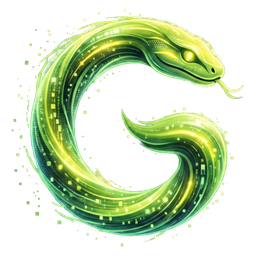

# Gula Studio

**Local AI character design, inpainting, film grading, and storyboard workstation engineered for 6 GB VRAM GPUs.**

English | [Tiếng Việt](README.vi.md) | [中文](README.zh.md) | [X @KhoaLe7722](https://x.com/KhoaLe7722)

**[Visual walkthrough](#visual-walkthrough) · [Capabilities](#capabilities) · [Architecture](#architecture) · [1-Click setup](#in-app-1-click-setup) · [Benchmarks](#benchmarks) · [Install](#install)**

<br />

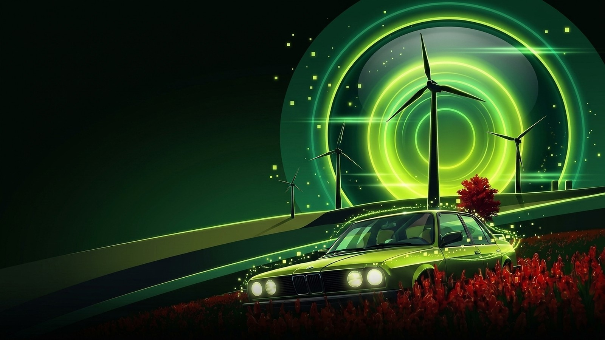

</div>

Gula Studio is a Windows app for game and comic artists who want to design characters and carry them across storyboard scenes with local ComfyUI. Generate a concept, repaint a detail with Magic Brush, then reuse character references across shots.

Start with the [app screenshots](#visual-walkthrough) or [build and run it on Windows](#build-and-run). See the [RTX 4050 Laptop GPU (6 GB) benchmarks](#benchmarks) for the measured workloads.

If Gula Studio helps with your workflow, give it a ⭐ using **Star** at the top of this page. To share a result or suggest an improvement, [open an issue](https://github.com/KhoaLe7722/Gula_Studio/issues).

> **A note from the author:** Hi, I'm **Lê Anh Khoa** (feel free to call me **Khoa Lê**). I built Gula Studio because most modern image-generation stacks either demand 48–80 GB server GPUs, lock private character scripts behind cloud subscriptions, or force artists to wrestle with fragile node graphs and dozens of scattered Hugging Face folders. Gula Studio puts **Z-Image-Turbo INT8**, **Magic Brush inpainting**, **real-time 0-GPU film color grading**, **0-VRAM multi-angle face identity lock**, and a **1-click in-app setup manager** into one native Windows desktop app that runs offline on a 6 GB laptop GPU.
>
> GitHub: [github.com/KhoaLe7722](https://github.com/KhoaLe7722) · X: [x.com/KhoaLe7722](https://x.com/KhoaLe7722) · Email: `leanhkhoa7722@gmail.com`

---

## Visual walkthrough

Every screenshot below is captured directly from the live WPF desktop application.

**bento-studio · Dark and Light workspace**

Click any card on the Bento inspiration wall to load curated prompts, framing, and styles immediately, type or dictate your own idea, or switch the entire UI live between English, Vietnamese, and Simplified Chinese (`EN / VI / 中文`).

<table>
  <tr>
    <td width="50%">
      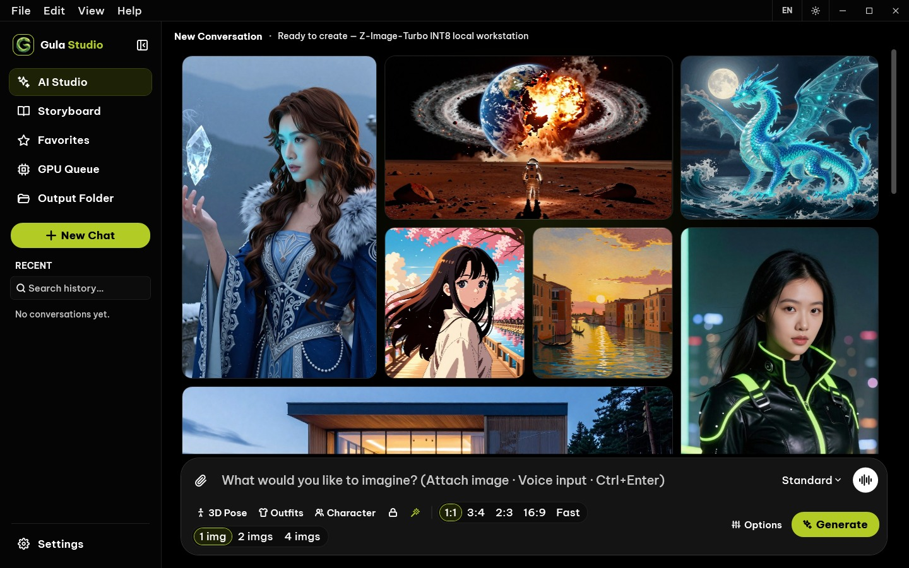
    </td>
    <td width="50%">
      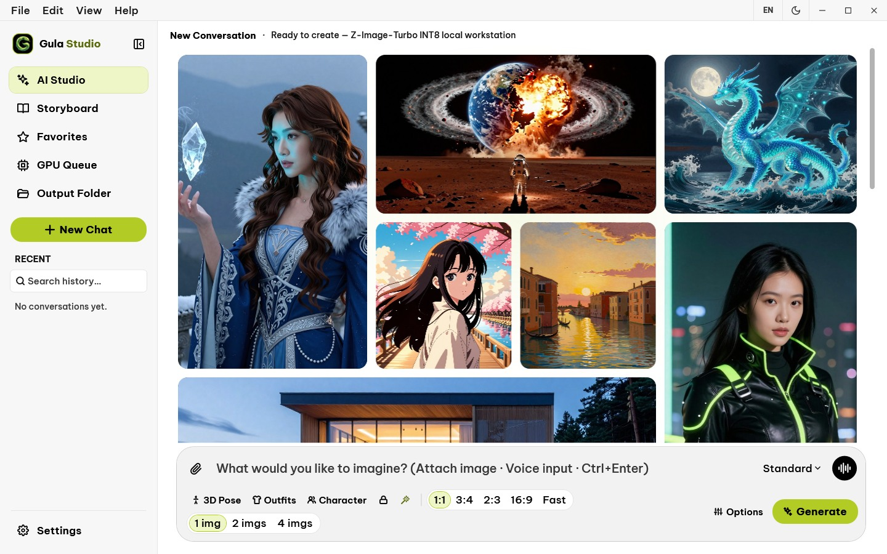
    </td>
  </tr>
</table>

**magic-brush-inpaint · Paint over any object or region and let AI redraw it**

Brush directly onto an object, hand, outfit, or background area, adjust brush size or erase strokes, describe the replacement, and run ControlNet-guided local inpainting or canvas outpainting (`16:9`, `1:1`, `9:16`).

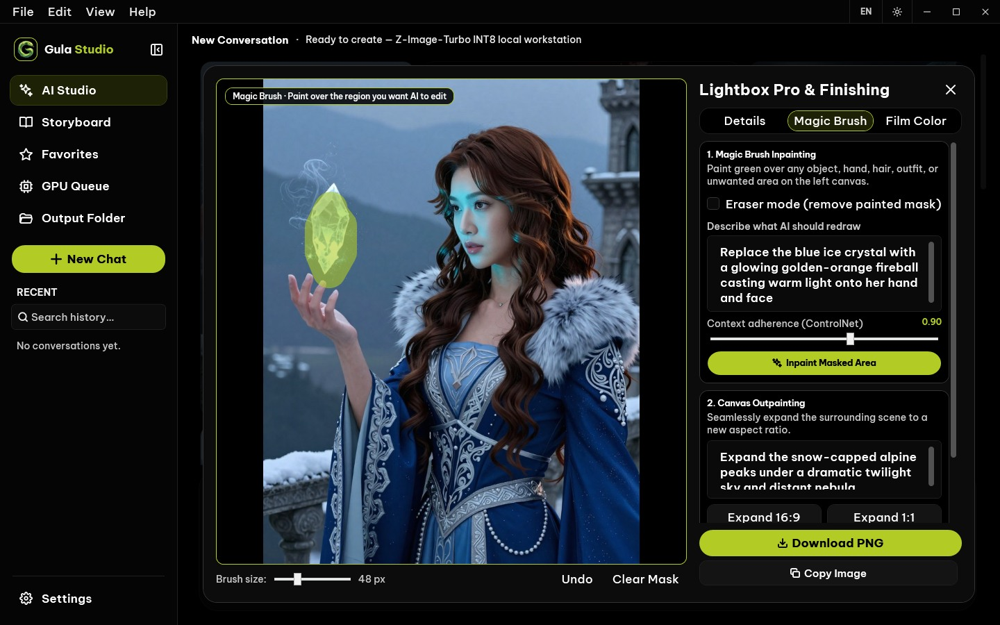

**film-color-grading · Real-time 0-GPU BGRA film presets and 7 live tone sliders**

Grade any generated artwork directly on CPU at zero GPU cost using built-in cinema looks (`Kodak Portra`, `Fuji Chrome`, `Teal & Orange`, `Clear Japan`, `Warm Sunset`, `Leica B&W`) plus live `Exposure`, `Contrast`, `Saturation`, `Warmth`, `Clarity`, `35mm Film Grain`, and `Vignette` sliders.

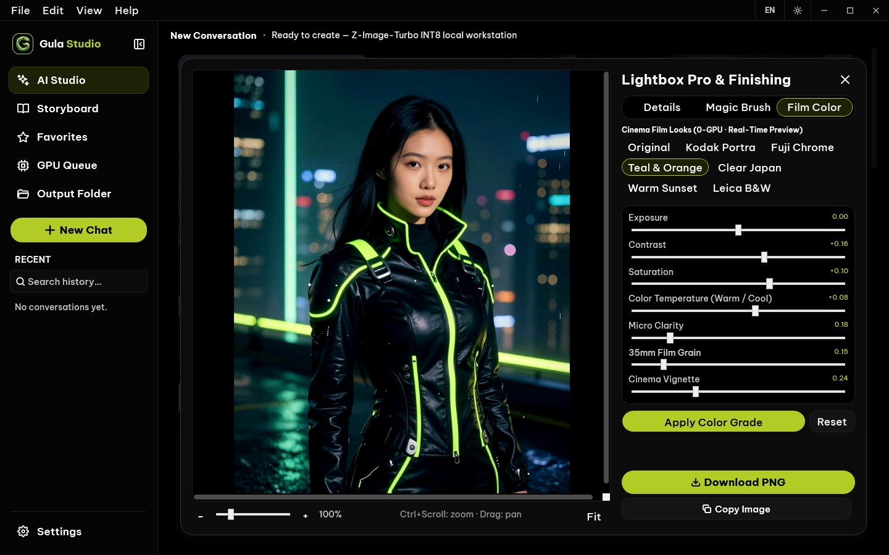

**lightbox-pro · 2K Tiled Hires-Fix and 0-VRAM transparent PNG cutout**

Inspect generations at 100% zoom, enhance detail to 2K via 2×2 overlapping Hann-blended tiles under 5.5 GB VRAM, or extract a clean transparent PNG cutout with Bria RMBG-1.4 running entirely on CPU (`0 MB VRAM`).

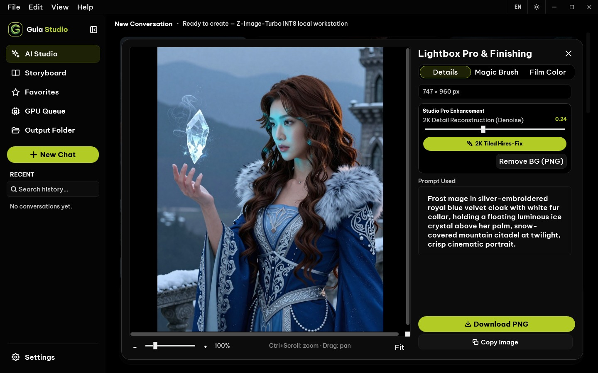

**pro-controls · Styles, lighting, lenses, LoRA stacking, and poster typography**

Configure art direction, camera lenses, lighting moods, up to 3 stacked custom LoRAs, verbatim bilingual poster typography, or a 9-expression character turnaround sheet.

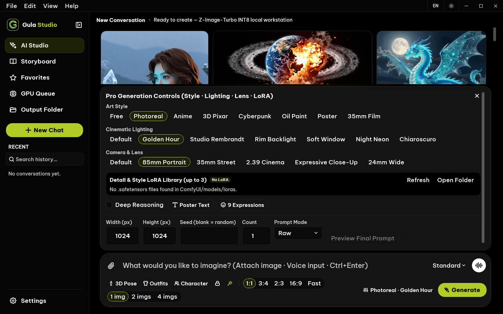

**storyboard · Multi-scene continuity with 0-VRAM multi-angle Face Identity Lock**

Build a cast of recurring characters with 1–5 reference angles each and preserve facial identity across scenes using SCRFD + ArcFace + HyperSwap 256 + GFPGAN v1.4 on ONNX Runtime CPU (`0 MB GPU VRAM`).

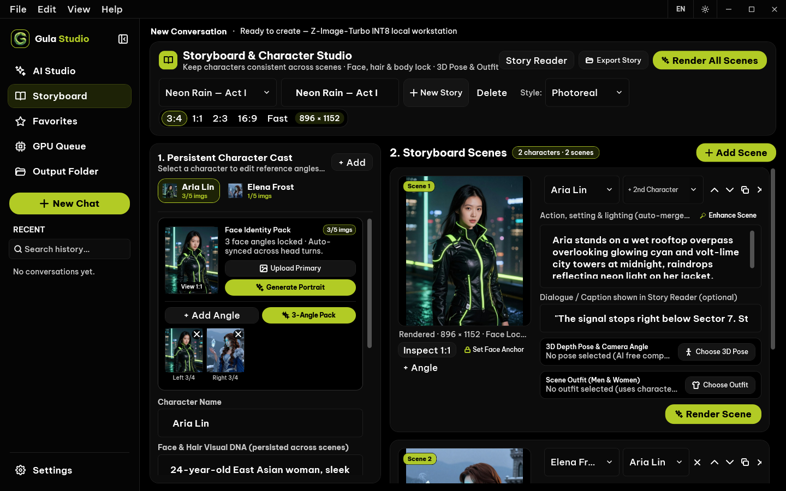

**outfit-library · 2,172 multi-angle outfits for men, women, and unisex casts**

Filter 2,172 structured wardrobe presets across modern fashion, streetwear, formal wear, fantasy, sci-fi, and traditional attire, with automatic prompt composition.

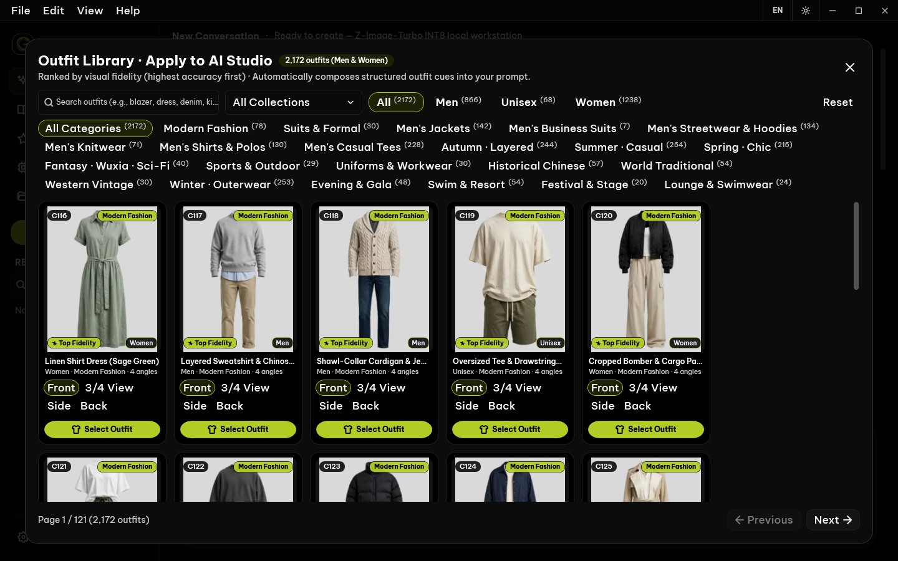

**setup-manager · In-app 1-click installer for ComfyUI, custom nodes, and AI models**

Open `File → Setup & Model Manager` to detect GPU, SQL Server, Python, and free disk space automatically, choose any target drive, and download all required runtimes and weights with resumable HTTP Range streaming.

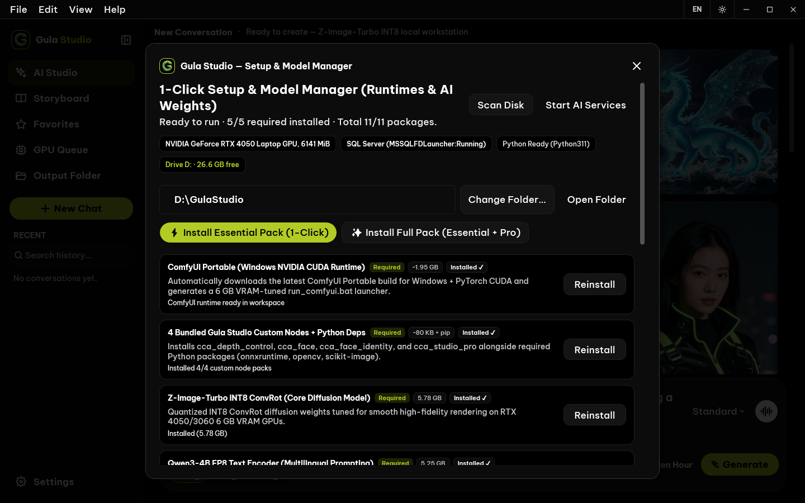

---

## Capabilities

| Module | What it does |
|---|---|
| `Z-Image-Turbo INT8` | Runs quantized `z_image_turbo_int8_convrot` + `qwen_3_4b_fp8_mixed` + `ae.safetensors` with DynamicVRAM offloading and resolution-aware AuraFlow timestep shifting on 6 GB GPUs. |
| `Magic Brush & Outpaint` | Interactive WPF mask painter with undo, erase mode, adjustable brush radius, ControlNet context adherence slider, and one-click `16:9` / `1:1` / `9:16` canvas expansion. |
| `Film Color Grading` | Zero-GPU BGRA pixel pipeline offering 6 cinema film presets and 7 live tone/texture sliders with non-destructive reset and direct PNG export. |
| `Lightbox Pro Finishing` | 2×2 overlapping **Tiled Hires-Fix 2K** (2D Hann blending under 5.5 GB VRAM), **Bria RMBG-1.4** alpha cutout (`0 MB VRAM`), and 2×/4× super-resolution. |
| `0-VRAM Face Lock` | `CcaFaceIdentitySwap` and `CcaDualFaceIdentitySwap` fuse 1–5 reference angles via SCRFD 10G + ArcFace WebFace600K + HyperSwap 256 + GFPGAN v1.4 + CIE LAB lighting match strictly on CPU ONNX. |
| `3D Depth Pose & Outfits` | 739 multi-angle 3D Depth poses (`CcaDepthLetterboxResize` + smooth cosine ControlNet ramp-down) and 2,172 multi-angle outfits synced directly into prompts. |
| `Offline Voice-to-Prompt` | Built-in `Whisper.net` (`Large-v3 Turbo`) over Vulkan/CPU (~0.8 s transcription) with automatic VRAM release before ComfyUI renders. |
| `Local CoT Prompt Enhancer` | 3-tier Tongyi-MAI `pe.py` enhancer: local `llama-server` (`Qwen3-4B GGUF`) with zero-conflict VRAM handoff, ComfyUI Qwen3, and deterministic Z-Captioner fallback. |
| `1-Click Setup Manager` | Downloads and configures ComfyUI Portable, all 4 bundled Gula Studio custom nodes + `pip` packages, and 11 official Hugging Face / GitHub Releases assets inside the app. |
| `Team & Safety Controls` | Master family-safe NSFW lock, durable SQL Server single-GPU lease queue, ASP.NET Core Identity bearer auth, per-project RBAC (`Owner / Designer / Viewer`), and immutable revision history. |

---

## Architecture

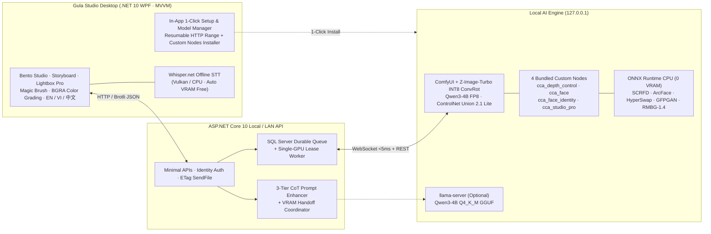

---

## In-app 1-click setup

Open **File → Setup & Model Manager** (or **Settings**) inside Gula Studio to install any combination of the **11 verified packages**. Every download uses official Hugging Face or GitHub Releases URLs with automatic `.part` resume, disk-space pre-checks, and zero hardcoded paths (`GULA_STUDIO_HOME` or any folder you select in the UI).

| # | Package | Tier | Size | Destination |
|---:|---|---|---:|---|
| 1 | ComfyUI Portable (Windows NVIDIA) | Required | ~1.95 GB | `ComfyUI/` + portable `run_comfyui.bat` |
| 2 | 4 Gula Studio Custom Nodes + `pip` deps | Required | ~80 KB | `ComfyUI/custom_nodes/cca_*` |
| 3 | Z-Image-Turbo INT8 ConvRot | Required | 5.78 GB | `ComfyUI/models/diffusion_models/` |
| 4 | Qwen3-4B FP8 Text Encoder | Required | 5.25 GB | `ComfyUI/models/text_encoders/` |
| 5 | Autoencoder VAE (`ae.safetensors`) | Required | 320 MB | `ComfyUI/models/vae/` |
| 6 | ControlNet Union 2.1 Lite (8-steps) | Recommended | 1.92 GB | `ComfyUI/models/model_patches/` |
| 7 | CPU Face Identity Pack (5 ONNX models) | Recommended | 892 MB | `ComfyUI/models/cca_face_identity/` |
| 8 | Bria RMBG-1.4 ONNX Background Removal | Recommended | 168 MB | `ComfyUI/models/background_removal/` |
| 9 | Super-Resolution Pack (RealESRGAN + UltraSharp + NMKD) | Recommended | 192 MB | `ComfyUI/models/upscale_models/` |
| 10 | Whisper Large-v3 Turbo STT (`ggml-large-v3-turbo-q5_0`) | Optional | 547 MB | `SpeechToText/models/` |
| 11 | Local Prompt Enhancer (`llama-server` + `Qwen3-4B Q4_K_M`) | Optional | ~2.7 GB | `PromptEnhancer/` |

---

## Benchmarks

Measured locally on **NVIDIA GeForce RTX 4050 Laptop GPU (6,141 MiB VRAM)** with PyTorch CUDA (`--fast fp16_accumulation --reserve-vram 0.8`):

| Workload | Resolution | VRAM Footprint | Typical Latency |
|---|---:|---:|---:|
| Z-Image-Turbo INT8 (9 steps, Fast T2I) | `1024 × 1024` | ≤ 5.6 GB (DynamicVRAM) | ~18–25 s |
| Widescreen Storyboard Scene (20:11) | `1280 × 704` | ≤ 5.7 GB | ~22–30 s |
| 3D Pose ControlNet Union 2.1 Lite | `896 × 1152` | ≤ 5.8 GB | ~24–32 s |
| CPU Face Identity Lock (SCRFD + HyperSwap + GFPGAN) | `256 / 512 face` | `0 MB GPU` (CPU ONNX) | ~2.5–4.0 s |
| Bria RMBG-1.4 Transparent Alpha Cutout | `1024 × 1024` | `0 MB GPU` (CPU ONNX) | ~1.8–3.0 s |
| Real-Time BGRA Film Color Grading | Full resolution | `0 MB GPU` (CPU BGRA) | < 0.05 s |
| Tiled Hires-Fix 2K (2×2 Hann 2D Blend) | `2048 × 2048` | ≤ 5.5 GB | ~45–65 s |
| Whisper Large-v3 Turbo Voice-to-Prompt | `16 kHz PCM` | Auto-freed on idle | ~0.8 s |

---

## Install

### Requirements

- **OS:** Windows 10 / 11 (64-bit)
- **GPU:** NVIDIA RTX / GTX with 6 GB+ VRAM (CUDA driver)
- **RAM:** 16 GB+ recommended
- **Runtime:** [.NET 10 SDK / Desktop Runtime](https://dotnet.microsoft.com/download/dotnet/10.0) and [SQL Server Express](https://www.microsoft.com/en-us/sql-server/sql-server-downloads) *(linked directly inside Setup Manager)*

### Build and run

```powershell
git clone https://github.com/KhoaLe7722/Gula_Studio.git
cd Gula_Studio
dotnet build CharacterConceptAI.slnx -c Release
.\Chay-Ung-Dung.bat
```

On first launch, open **File → Setup & Model Manager**, pick your preferred drive, and click the one-click installer to fetch ComfyUI, bundled custom nodes, and required model weights automatically.

### Verification

```powershell
# 79 backend, security, queue, and AI pipeline unit/integration tests
dotnet test CharacterConceptAI.slnx -c Release

# Automated WPF UI smoke harness (77 renders · 102 checks · 0 binding warnings)
dotnet build tests/CharacterConceptAI.Desktop.Smoke/CharacterConceptAI.Desktop.Smoke.csproj -c Release
.\tests\CharacterConceptAI.Desktop.Smoke\bin\Release\net10.0-windows\CharacterConceptAI.Desktop.Smoke.exe .\artifacts\ui-smoke
```

---

## Keyboard shortcuts

| Shortcut | Action |
|---|---|
| `Ctrl + Enter` | Generate image from current prompt |
| `Ctrl + N` | Start a new creation thread |
| `Ctrl + B` | Toggle left navigation sidebar |
| `Ctrl + ,` | Open Settings & Setup Manager |
| `Ctrl + F` | Search conversation, character, or project history |
| `Ctrl + +` / `Ctrl + -` / `Ctrl + 0` | Zoom workspace UI (80% – 130%) / Reset 100% |
| `F11` | Toggle Full Screen mode |
| `Ctrl + M` | Minimize window |
| `←` / `→` | Navigate images inside Lightbox Pro |
| `F1` / `Esc` | Open shortcuts reference / Close active overlay |

---

## Repository structure

```text
Gula_Studio/
├── Chay-Ung-Dung.bat                         # One-click Windows launcher
├── CharacterConceptAI.slnx                   # .NET 10 solution
├── src/
│   ├── CharacterConceptAI.Desktop/           # WPF Desktop App (MVVM, Bento UI, Lightbox Pro, Setup Manager, Whisper STT)
│   ├── CharacterConceptAI.Server/            # ASP.NET Core 10 API, SQL GPU Queue, ComfyUI & Enhancer Clients
│   └── CharacterConceptAI.Shared.Contracts/  # Shared strongly-typed DTO contracts
├── scripts/
│   ├── comfyui/custom_nodes/                 # 4 bundled ComfyUI custom nodes (Depth, Face, Identity, StudioPro)
│   ├── deploy/                               # LAN deployment, Windows Service, backup/restore & supervision
│   └── start-desktop.ps1                     # Portable local launcher
├── tests/
│   ├── CharacterConceptAI.Tests/             # 79 unit & integration tests (xUnit)
│   └── CharacterConceptAI.Desktop.Smoke/     # Automated WPF visual & binding verification harness
└── docs/                                     # Architecture specs, screenshots & engineering documentation
```

---

## Star history

<a href="https://www.star-history.com/#KhoaLe7722/Gula_Studio&Date">
  
</a>

---

## Author & license

Created by **Lê Anh Khoa (Khoa Lê)** — [GitHub](https://github.com/KhoaLe7722) · [X @KhoaLe7722](https://x.com/KhoaLe7722) · [leanhkhoa7722@gmail.com](mailto:leanhkhoa7722@gmail.com).

Distributed under the **MIT License** ([`LICENSE`](LICENSE)). Third-party AI model weights downloaded through the In-App Setup Manager remain subject to their respective upstream licenses (Tongyi-MAI / Alibaba PAI / Qwen / Bria AI / FaceFusion / InsightFace).
