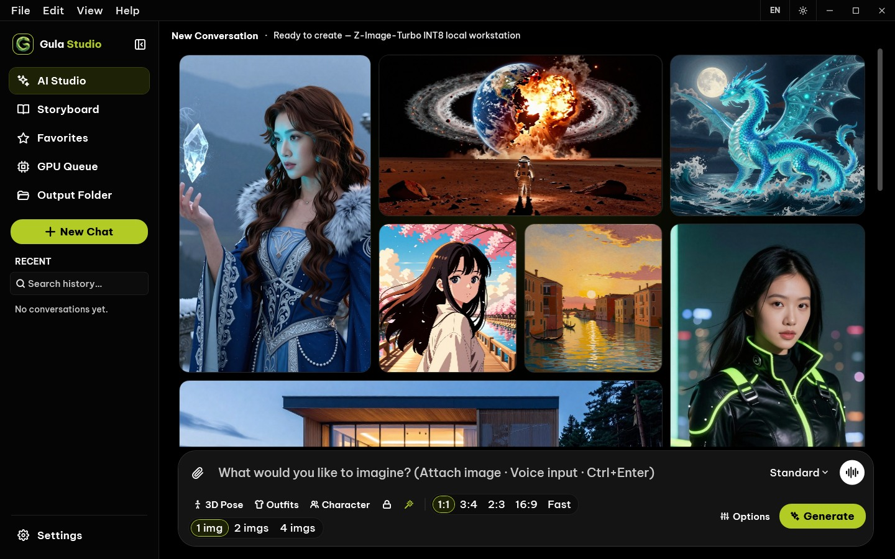
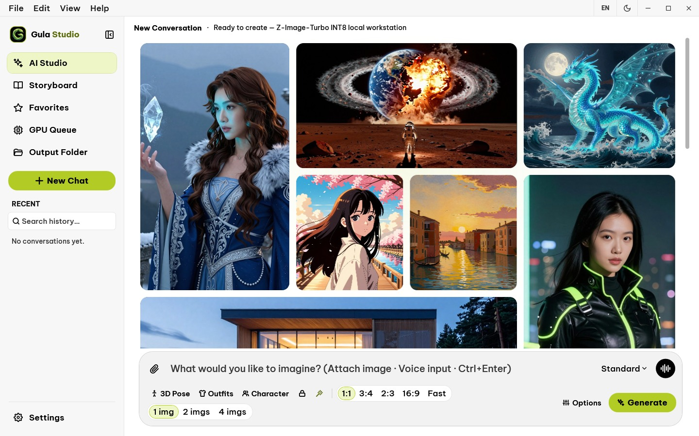
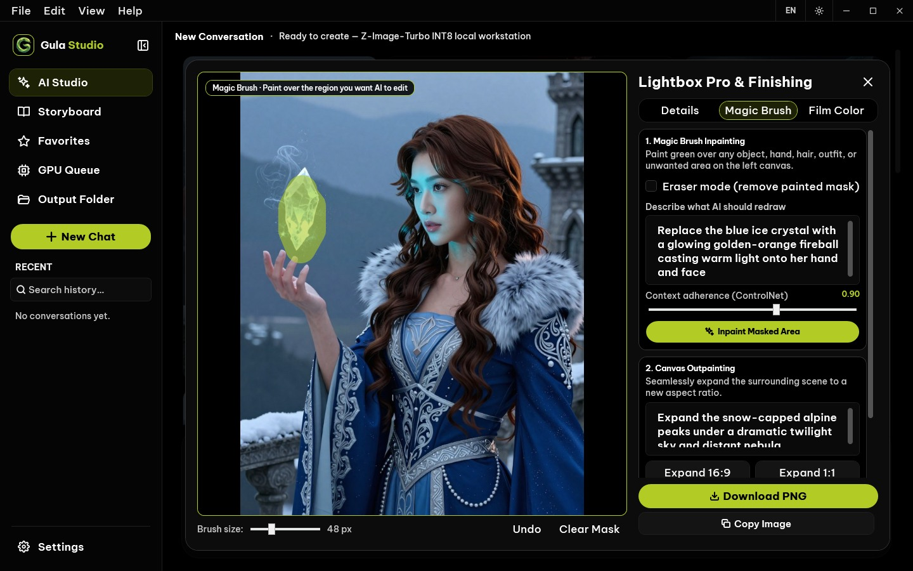
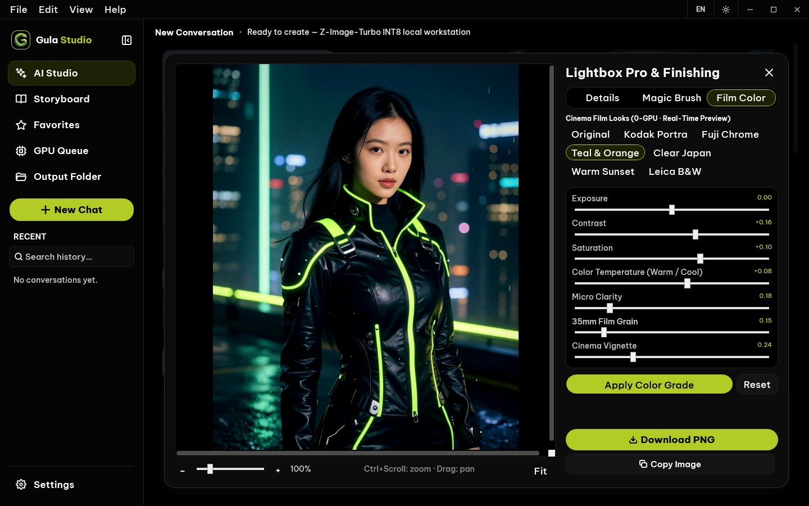
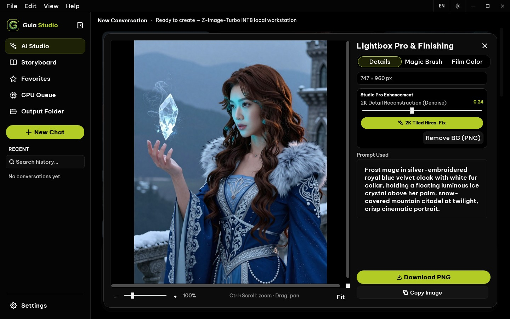
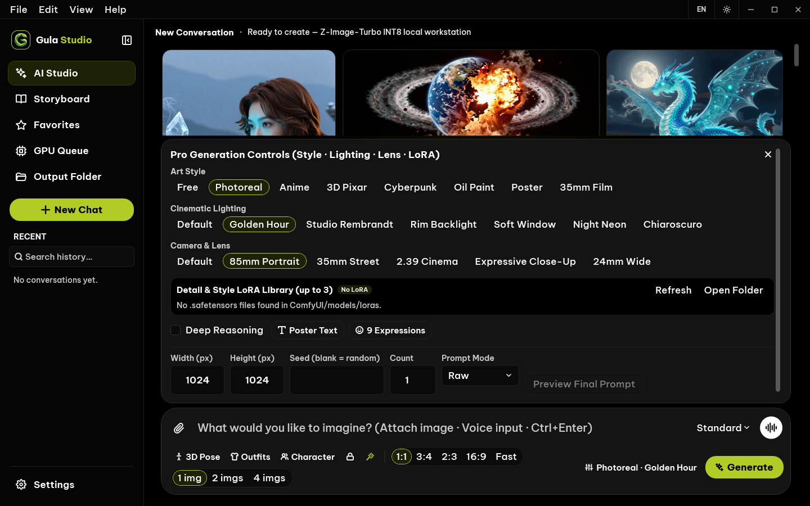
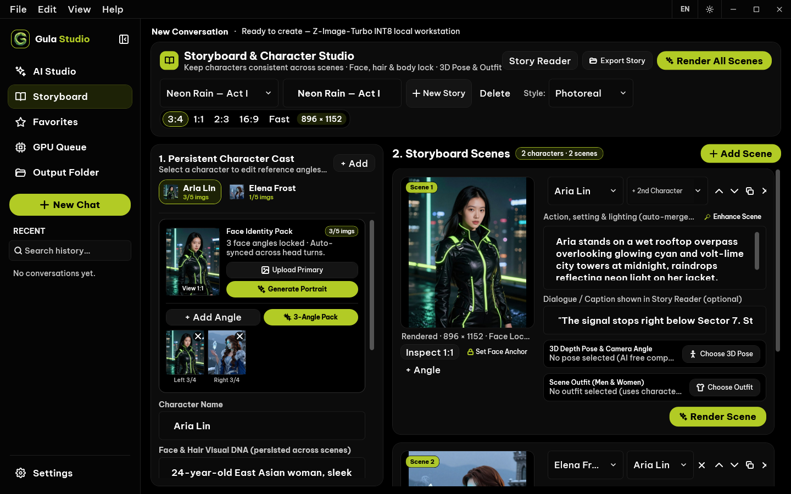
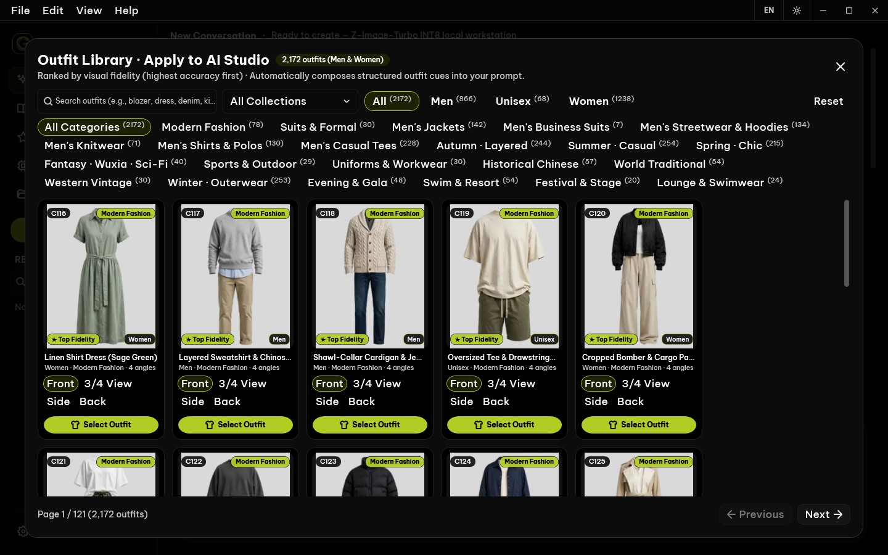
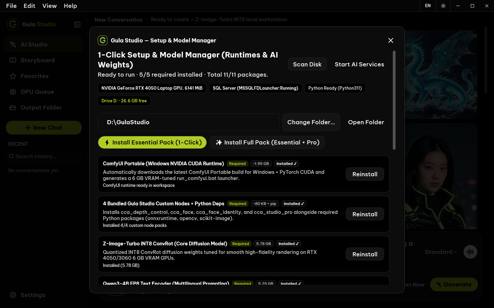
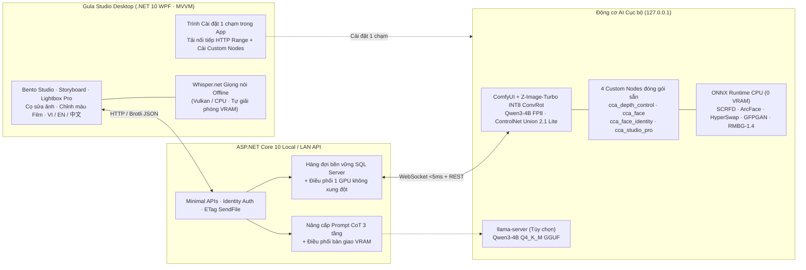

<div align="center">


# Gula Studio

**Trạm làm việc tạo ảnh AI, cọ sửa vùng ảnh, chỉnh màu Film và dựng Storyboard chạy cục bộ cho GPU 6 GB VRAM.**

[English](README.md) | Tiếng Việt | [中文](README.zh.md) | [X @KhoaLe7722](https://x.com/KhoaLe7722)

**[Tổng quan tính năng qua ảnh](#tổng-quan-tính-năng-qua-ảnh) · [Tính năng cốt lõi](#tính-năng-cốt-lõi) · [Kiến trúc](#kiến-trúc) · [Cài đặt 1 chạm](#cài-đặt-mô-hình-1-chạm-trong-app) · [Hiệu năng](#hiệu-năng-rtx-4050-6-gb) · [Cài đặt](#cài-đặt)**

<br />


</div>

Gula Studio là ứng dụng Windows cho họa sĩ game và truyện tranh muốn thiết kế nhân vật và giữ diện mạo nhất quán qua nhiều cảnh bằng ComfyUI chạy trên máy. Bạn có thể tạo ảnh concept, dùng Magic Brush để vẽ lại một chi tiết, rồi tái sử dụng ảnh tham chiếu nhân vật trong storyboard.

Bạn có thể [xem ảnh giao diện](#tổng-quan-tính-năng-qua-ảnh) hoặc [biên dịch và chạy trên Windows](#biên-dịch-và-khởi-chạy). Mục [hiệu năng trên RTX 4050 Laptop 6 GB](#hiệu-năng-rtx-4050-6-gb) ghi lại các tác vụ đã đo.

Nếu Gula Studio hữu ích cho công việc của bạn, hãy bấm **Star** ⭐ ở đầu trang. Bạn cũng có thể [mở issue](https://github.com/KhoaLe7722/Gula_Studio/issues) để chia sẻ kết quả hoặc góp ý.

> **Đôi lời từ tác giả:** Chào bạn, cảm ơn bạn đã ghé qua Gula Studio. Mình là **Lê Anh Khoa** (bạn cứ gọi mình là **Khoa Lê** nhé). Mình làm Gula Studio vì hầu hết các hệ thống tạo ảnh AI chất lượng cao hiện nay đều đòi GPU máy chủ 48–80 GB, thu phí cloud hàng tháng, hoặc bắt người dùng tự ghép node ComfyUI và tìm tải hàng chục file model rời rạc. Gula Studio gói gọn **Z-Image-Turbo INT8**, **cọ quét sửa chi tiết (Magic Brush Inpaint)**, **chỉnh màu Film 0 giây GPU**, **khóa khuôn mặt đa góc 0 VRAM** và **trình tự động tải cài đặt 1 chạm** vào một ứng dụng Windows duy nhất — chạy hoàn toàn ngoại tuyến ngay trên laptop RTX 4050 6 GB.
>
> GitHub: [github.com/KhoaLe7722](https://github.com/KhoaLe7722) · X: [x.com/KhoaLe7722](https://x.com/KhoaLe7722) · Gmail: `leanhkhoa7722@gmail.com`

---

## Tổng quan tính năng qua ảnh

Toàn bộ ảnh dưới đây được chụp trực tiếp từ ứng dụng desktop WPF đang chạy thực tế.

**bento-studio · Giao diện Sáng & Tối đồng bộ**

Nhấn vào bất kỳ thẻ mẫu nào trên tường Bento để nạp sẵn prompt, góc máy và phong cách, gõ hoặc nói ý tưởng bằng giọng nói, hoặc chuyển đổi trực tiếp 3 ngôn ngữ Anh · Việt · Trung (`EN / VI / 中文`) ngay lập tức không cần khởi động lại.

<table>
  <tr>
    <td width="50%">
      
    </td>
    <td width="50%">
      
    </td>
  </tr>
</table>

**co-sua-anh-inpaint · Quét vùng vật thể bằng cọ và nhờ AI vẽ lại, hoặc mở rộng khung hình**

Tô cọ xanh trực tiếp lên đồ vật, bàn tay, trang phục hoặc chi tiết thừa trên ảnh, tùy chỉnh cỡ cọ hoặc chế độ tẩy, nhập mô tả thứ bạn muốn thay thế và để AI tái tạo chuẩn ánh sáng bối cảnh; đi kèm tính năng mở rộng khung hình liền mạch (`16:9`, `1:1`, `9:16`).



**chinh-mau-film · Bộ lọc màu điện ảnh 0 giây GPU và 7 thanh chỉnh màu trực tiếp**

Chỉnh màu hậu kỳ ngay lập tức bằng pipeline BGRA trên CPU không tốn VRAM với 6 màu Film điện ảnh (`Kodak Portra`, `Fuji Chrome`, `Teal & Orange`, `Nhật Trong Trẻo`, `Hoàng Hôn Ấm`, `Leica B&W`) cùng 7 thanh trượt trực tiếp: Độ sáng, Tương phản, Độ bão hòa, Nhiệt màu, Độ nét vi mô, Hạt phim 35mm và Viền tối điện ảnh.



**hau-ky-lightbox-pro · Siêu nét 2K Tiled Hires-Fix và tách nền PNG trong suốt 0 VRAM**

Phóng to soi chi tiết 100%, nâng độ nét lên 2K bằng thuật toán chia ô 2×2 chồng lấp Hann dưới 5.5 GB VRAM, hoặc tách nền nhân vật xuất PNG trong suốt bằng Bria RMBG-1.4 chạy hoàn toàn trên CPU (`0 MB VRAM`).



**tuy-chinh-chuyen-sau · Phong cách, ánh sáng, ống kính, ghép LoRA và chèn chữ Poster**

Tinh chỉnh ánh sáng điện ảnh, tiêu cự máy ảnh, xếp chồng tối đa 3 LoRA tùy chọn, in chữ tiêu đề chuẩn xác trên poster hoặc xuất bảng 9 biểu cảm nhân vật.



**storyboard · Kể chuyện đa phân cảnh và khóa gương mặt đa góc 0 VRAM**

Tạo hồ sơ dàn nhân vật cố định (1–5 ảnh góc mặt cho mỗi nhân vật) và giữ nhất quán gương mặt xuyên suốt nhiều cảnh phim bằng SCRFD + ArcFace + HyperSwap 256 + GFPGAN v1.4 trên ONNX Runtime CPU (`0 MB VRAM`).



**kho-trang-phuc · 2,172 bộ trang phục Nam, Nữ và Unisex**

Lọc nhanh theo giới tính và hàng chục chủ đề từ thời trang hiện đại, streetwear, vest công sở, cổ trang, kiếm hiệp, sci-fi đến trang phục truyền thống — chọn là tự ghép vào prompt.



**cai-dat-1-cham · Tự động tải và cài đặt ComfyUI, custom nodes và 11 gói mô hình ngay trong app**

Vào `File → Setup & Model Manager` (hoặc mục Cài đặt) để tự kiểm tra GPU, SQL Server, Python và dung lượng ổ đĩa, chọn thư mục cài tùy ý và bấm 1 nút để tải tự động có hỗ trợ nối tiếp khi rớt mạng.



---

## Tính năng cốt lõi

| Phân hệ | Mô tả |
|---|---|
| `Z-Image-Turbo INT8` | Chạy `z_image_turbo_int8_convrot` + `qwen_3_4b_fp8_mixed` + `ae.safetensors` tối ưu DynamicVRAM và dịch chuyển bước thời gian AuraFlow vừa khít GPU 6 GB. |
| `Magic Brush & Outpaint` | Quét cọ trực tiếp lên đồ vật hoặc vùng cần sửa, có chế độ tẩy, hoàn tác, chỉnh độ bám bối cảnh ControlNet và mở rộng khung hình `16:9` / `1:1` / `9:16`. |
| `Chỉnh màu Film BGRA` | Hậu kỳ màu sắc tức thì trên CPU (`0 MB VRAM`) với 6 bộ lọc màu điện ảnh và 7 thanh trượt độ sáng, tương phản, nhiệt màu, độ nét, hạt phim 35mm, viền tối. |
| `Hậu kỳ Studio Pro` | Siêu nét 2K chia ô 2×2 Hann (< 5.5 GB VRAM), tách nền trong suốt **Bria RMBG-1.4** (`0 MB VRAM`) và nâng độ phân giải 2×/4×. |
| `Khóa mặt 0 VRAM` | `CcaFaceIdentitySwap` và `CcaDualFaceIdentitySwap` tổng hợp 1–5 góc mặt bằng SCRFD 10G + ArcFace WebFace600K + HyperSwap 256 + GFPGAN v1.4 + cân bằng sáng CIE LAB hoàn toàn trên CPU. |
| `Kho Dáng 3D & Trang phục` | 739 dáng 3D Depth (5 góc máy) và 2,172 bộ trang phục tự động đồng bộ vào prompt và ControlNet Union 2.1 Lite. |
| `Giọng nói ngoại tuyến` | Tích hợp `Whisper.net` (`Large-v3 Turbo`) nhận diện tiếng Việt/Anh ~0.8 giây và tự giải phóng VRAM ngay trước khi ComfyUI vẽ ảnh. |
| `Tối ưu Prompt CoT` | Hệ thống nâng cấp prompt 3 tầng: `llama-server` (`Qwen3-4B GGUF`) nhả VRAM không xung đột, ComfyUI Qwen3 và bộ dịch nhanh Z-Captioner. |
| `Trình cài đặt 1 chạm` | Tải và cài trọn bộ ComfyUI Portable, 4 custom nodes độc quyền + thư viện Python và 11 gói model chuẩn từ Hugging Face / GitHub Releases. |
| `An toàn & Làm việc nhóm` | Khóa an toàn nội dung, hàng đợi GPU bền vững trên SQL Server, xác thực ASP.NET Core Identity, phân quyền dự án (`Owner / Designer / Viewer`) và lưu lịch sử phiên bản. |

---

## Kiến trúc



---

## Cài đặt mô hình 1 chạm trong app

Bạn không cần tự đi tìm link tải hay sao chép thủ công từng thư mục. Mở **File → Setup & Model Manager** (hoặc **Cài đặt**) trong Gula Studio để tải tự động bất kỳ gói nào trong **11 gói chính thức** (có kiểm tra ổ đĩa, tải nối tiếp `.part` khi rớt mạng và cho phép chọn thư mục lưu bất kỳ qua `GULA_STUDIO_HOME`):

| # | Gói cài đặt | Mức độ | Dung lượng | Thư mục đích |
|---:|---|---|---:|---|
| 1 | ComfyUI Portable (Windows NVIDIA) | Bắt buộc | ~1.95 GB | `ComfyUI/` + `run_comfyui.bat` |
| 2 | 4 Custom Nodes Gula Studio + thư viện `pip` | Bắt buộc | ~80 KB | `ComfyUI/custom_nodes/cca_*` |
| 3 | Z-Image-Turbo INT8 ConvRot | Bắt buộc | 5.78 GB | `ComfyUI/models/diffusion_models/` |
| 4 | Qwen3-4B FP8 Text Encoder | Bắt buộc | 5.25 GB | `ComfyUI/models/text_encoders/` |
| 5 | Autoencoder VAE (`ae.safetensors`) | Bắt buộc | 320 MB | `ComfyUI/models/vae/` |
| 6 | ControlNet Union 2.1 Lite (8-steps) | Khuyên dùng | 1.92 GB | `ComfyUI/models/model_patches/` |
| 7 | Bộ khóa mặt CPU (5 model ONNX) | Khuyên dùng | 892 MB | `ComfyUI/models/cca_face_identity/` |
| 8 | Tách nền Bria RMBG-1.4 ONNX | Khuyên dùng | 168 MB | `ComfyUI/models/background_removal/` |
| 9 | Bộ nâng nét (RealESRGAN + UltraSharp + NMKD) | Khuyên dùng | 192 MB | `ComfyUI/models/upscale_models/` |
| 10 | Giọng nói Whisper Large-v3 Turbo (`q5_0`) | Tùy chọn | 547 MB | `SpeechToText/models/` |
| 11 | Nâng cấp Prompt cục bộ (`llama-server` + `Qwen3-4B`) | Tùy chọn | ~2.7 GB | `PromptEnhancer/` |

---

## Hiệu năng (RTX 4050 6 GB)

Đo thực tế trên **NVIDIA GeForce RTX 4050 Laptop GPU (6,141 MiB VRAM)** với PyTorch CUDA (`--fast fp16_accumulation --reserve-vram 0.8`):

| Tác vụ | Độ phân giải | Mức VRAM | Thời gian thực tế |
|---|---:|---:|---:|
| Z-Image-Turbo INT8 (9 bước, Fast T2I) | `1024 × 1024` | ≤ 5.6 GB (DynamicVRAM) | ~18–25 giây |
| Phân cảnh Storyboard màn ảnh rộng (20:11) | `1280 × 704` | ≤ 5.7 GB | ~22–30 giây |
| Dáng 3D ControlNet Union 2.1 Lite | `896 × 1152` | ≤ 5.8 GB | ~24–32 giây |
| Khóa khuôn mặt CPU (SCRFD + HyperSwap + GFPGAN) | `256 / 512 face` | `0 MB GPU` (CPU ONNX) | ~2.5–4.0 giây |
| Tách nền trong suốt Bria RMBG-1.4 | `1024 × 1024` | `0 MB GPU` (CPU ONNX) | ~1.8–3.0 giây |
| Chỉnh màu Film trực tiếp (BGRA) | Toàn độ phân giải | `0 MB GPU` (CPU BGRA) | < 0.05 giây |
| Siêu nét 2K Tiled Hires-Fix (2×2 Hann 2D) | `2048 × 2048` | ≤ 5.5 GB | ~45–65 giây |
| Giọng nói Whisper Large-v3 Turbo | `16 kHz PCM` | Tự giải phóng VRAM | ~0.8 giây |

---

## Cài đặt

### Yêu cầu hệ thống

- **Hệ điều hành:** Windows 10 / 11 (64-bit)
- **GPU:** NVIDIA RTX / GTX từ 6 GB VRAM trở lên (hỗ trợ CUDA)
- **RAM:** Khuyến nghị từ 16 GB trở lên
- **Môi trường:** [.NET 10 SDK / Desktop Runtime](https://dotnet.microsoft.com/download/dotnet/10.0) và [SQL Server Express](https://www.microsoft.com/en-us/sql-server/sql-server-downloads) *(có nút mở cài đặt ngay trong Trình Cài đặt của app)*

### Biên dịch và khởi chạy

```powershell
git clone https://github.com/KhoaLe7722/Gula_Studio.git
cd Gula_Studio
dotnet build CharacterConceptAI.slnx -c Release
.\Chay-Ung-Dung.bat
```

Lần đầu mở app, chọn **File → Setup & Model Manager**, chọn ổ đĩa muốn lưu và nhấn cài đặt tự động để tải ComfyUI, custom nodes và các model cần thiết.

### Kiểm thử tự động

```powershell
# 79 bài kiểm thử backend, bảo mật, hàng đợi GPU và pipeline AI
dotnet test CharacterConceptAI.slnx -c Release

# Kiểm thử giao diện WPF tự động (77 lượt render · 102 kiểm tra · 0 cảnh báo binding)
dotnet build tests/CharacterConceptAI.Desktop.Smoke/CharacterConceptAI.Desktop.Smoke.csproj -c Release
.\tests\CharacterConceptAI.Desktop.Smoke\bin\Release\net10.0-windows\CharacterConceptAI.Desktop.Smoke.exe .\artifacts\ui-smoke
```

---

## Phím tắt

| Phím tắt | Chức năng |
|---|---|
| `Ctrl + Enter` | Tạo ảnh từ prompt hiện tại |
| `Ctrl + N` | Tạo cuộc trò chuyện sáng tác mới |
| `Ctrl + B` | Ẩn / hiện thanh điều hướng bên trái |
| `Ctrl + ,` | Mở Cài đặt & Trình Cài đặt Mô hình |
| `Ctrl + F` | Tìm kiếm lịch sử trò chuyện / nhân vật / dự án |
| `Ctrl + +` / `Ctrl + -` / `Ctrl + 0` | Phóng to / thu nhỏ giao diện (80% – 130%) / 100% |
| `F11` | Bật / tắt chế độ Toàn màn hình |
| `Ctrl + M` | Thu nhỏ cửa sổ |
| `←` / `→` | Chuyển ảnh trong Studio Hậu kỳ (Lightbox Pro) |
| `F1` / `Esc` | Mở bảng phím tắt / Đóng hộp thoại hiện tại |

---

## Cấu trúc mã nguồn

```text
Gula_Studio/
├── Chay-Ung-Dung.bat                         # Khởi chạy nhanh 1 chạm trên Windows
├── CharacterConceptAI.slnx                   # Solution .NET 10
├── src/
│   ├── CharacterConceptAI.Desktop/           # Ứng dụng WPF (MVVM, Bento UI, Lightbox Pro, Cài đặt 1 chạm, Whisper STT)
│   ├── CharacterConceptAI.Server/            # ASP.NET Core 10 API, Hàng đợi GPU SQL, ComfyUI & Enhancer Clients
│   └── CharacterConceptAI.Shared.Contracts/  # Hợp đồng DTO dùng chung
├── scripts/
│   ├── comfyui/custom_nodes/                 # 4 custom nodes đóng gói sẵn (Depth, Face, Identity, StudioPro)
│   ├── deploy/                               # Triển khai LAN, Windows Service, sao lưu/khôi phục
│   └── start-desktop.ps1                     # Trình khởi động thông minh không cố định đường dẫn
├── tests/
│   ├── CharacterConceptAI.Tests/             # 79 bài kiểm thử đơn vị & tích hợp (xUnit)
│   └── CharacterConceptAI.Desktop.Smoke/     # Hệ thống kiểm thử giao diện WPF tự động
└── docs/                                     # Tài liệu kỹ thuật và hình ảnh minh họa
```

---

## Lịch sử ngôi sao

<a href="https://www.star-history.com/#KhoaLe7722/Gula_Studio&Date">
  
</a>

---

## Tác giả & giấy phép

Phát triển bởi **Lê Anh Khoa (Khoa Lê)** — [GitHub](https://github.com/KhoaLe7722) · [X @KhoaLe7722](https://x.com/KhoaLe7722) · [leanhkhoa7722@gmail.com](mailto:leanhkhoa7722@gmail.com).

Phát hành theo giấy phép **MIT** ([`LICENSE`](LICENSE)). Các trọng số mô hình AI bên thứ ba được tải qua Trình Cài đặt trong ứng dụng tuân thủ giấy phép gốc của tác giả mô hình tương ứng (Tongyi-MAI / Alibaba PAI / Qwen / Bria AI / FaceFusion / InsightFace).
