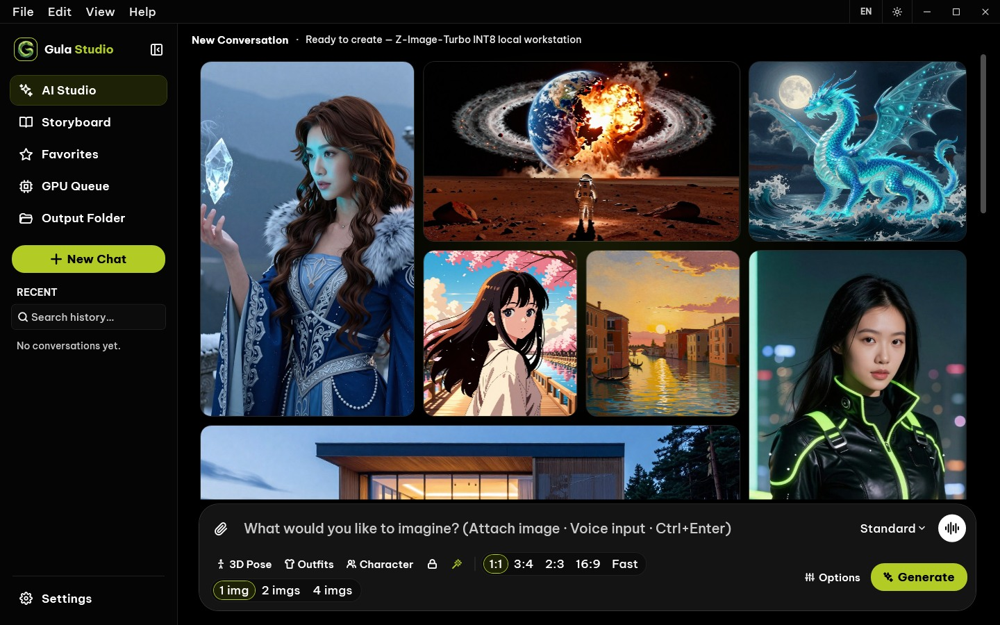
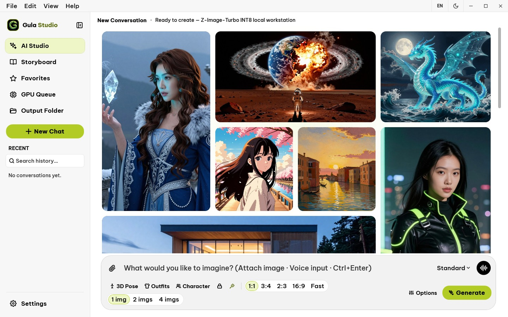
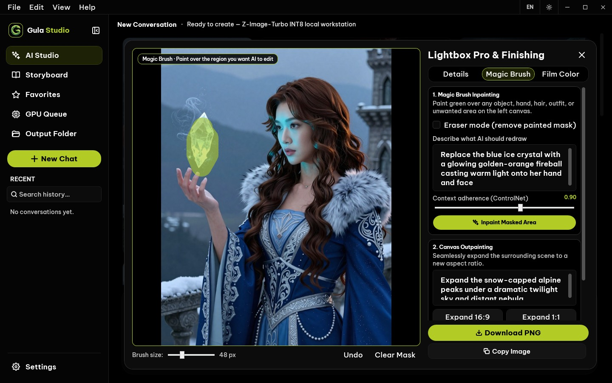
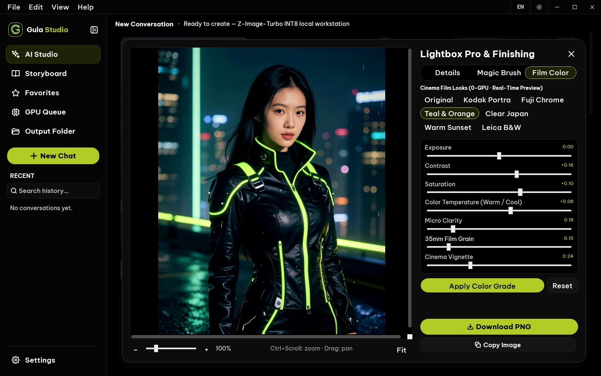
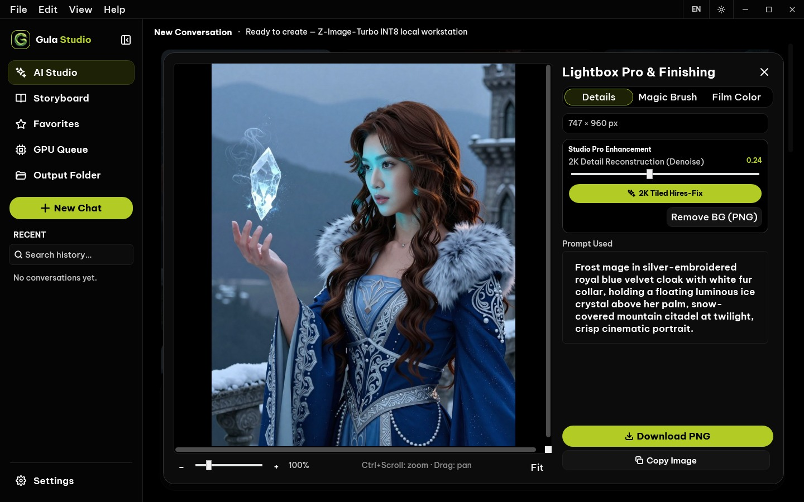
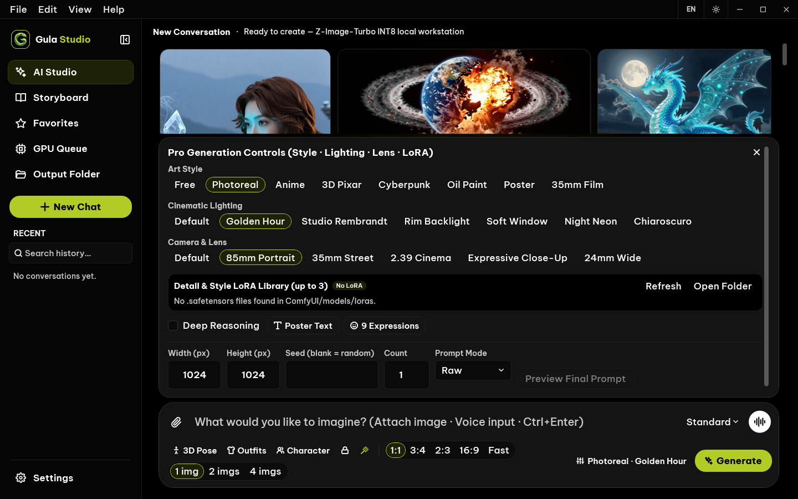
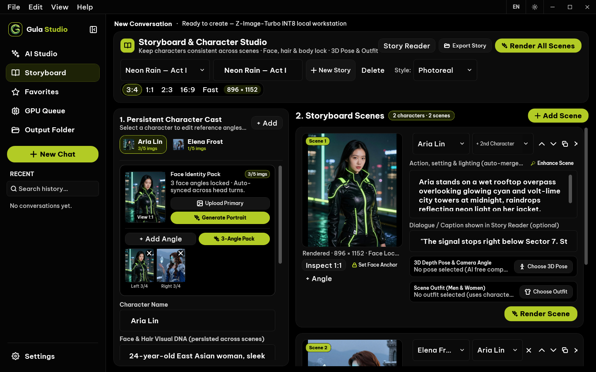
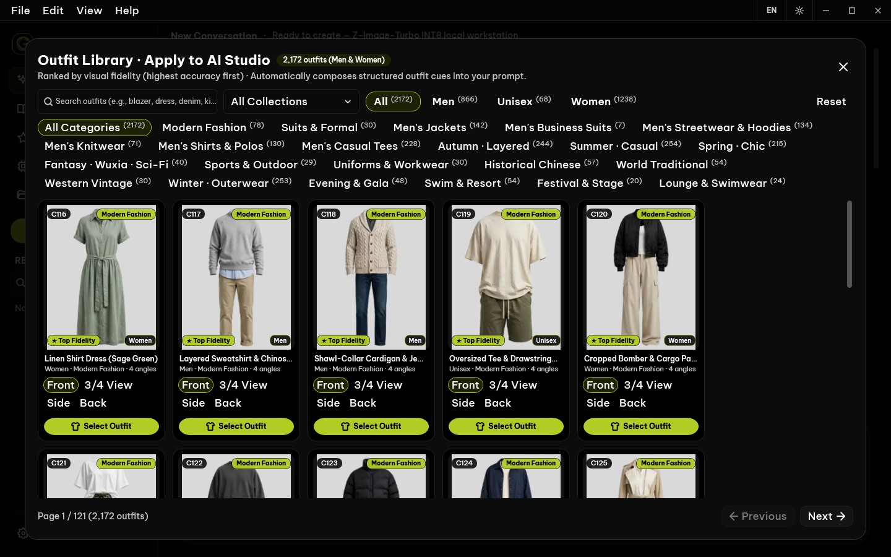
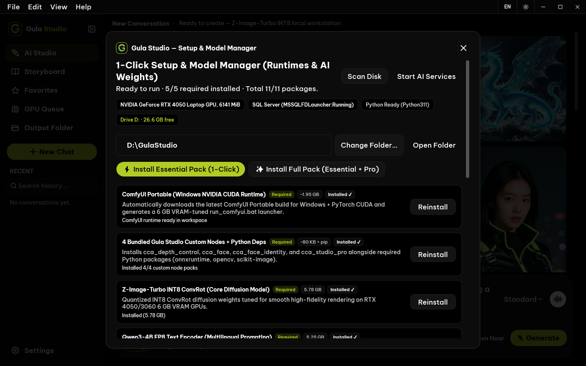
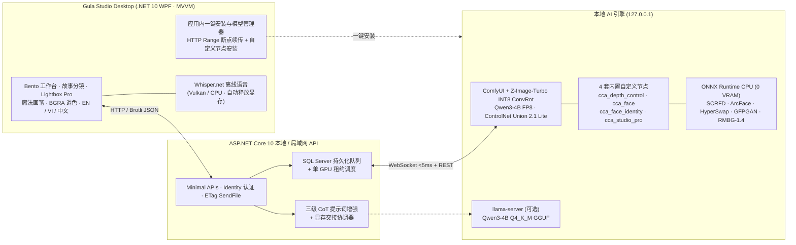

<div align="center">


# Gula Studio

**专为 6 GB 显存 GPU 打造的本地 AI 角色设计、画笔局部重绘、胶片调色与故事分镜工作站。**

[English](README.md) | [Tiếng Việt](README.vi.md) | 中文 | [X @KhoaLe7722](https://x.com/KhoaLe7722)

**[功能实拍总览](#功能实拍总览) · [核心能力](#核心能力) · [系统架构](#系统架构) · [应用内一键安装](#应用内一键安装) · [性能基准](#性能基准) · [快速开始](#快速开始)**

<br />


</div>

Gula Studio 是一款面向游戏和漫画创作者的 Windows 应用。通过本地 ComfyUI 生成角色概念图，用魔法画笔重绘细节，再在多个分镜中复用角色参考图。

你可以先[查看界面截图](#功能实拍总览)，或[在 Windows 上编译并运行](#编译与启动)。[性能基准](#性能基准)记录了 RTX 4050 笔记本 GPU（6 GB 显存）上的实测任务。

如果 Gula Studio 对你的创作有帮助，欢迎点击页面顶部的 **Star** ⭐。也可以[提交 issue](https://github.com/KhoaLe7722/Gula_Studio/issues)分享成果或提出建议。

> **作者的话：** 你好，感谢体验 Gula Studio。我是 **Lê Anh Khoa**（叫我 **Khoa Lê** 就好）。主流高质量生图方案要么需要 48–80 GB 服务器显卡，要么按月收取云端费用，或者要求用户手工拼接 ComfyUI 节点并四处寻找零散模型。Gula Studio 将 **Z-Image-Turbo INT8**、**魔法画笔局部重绘（Magic Brush）**、**0 显存实时胶片调色**、**0 显存多角度人脸锁定** 以及 **应用内一键下载安装器** 集成到一个原生 Windows 桌面程序中，在 6 GB 显存笔记本上即可完全离线运行。
>
> GitHub: [github.com/KhoaLe7722](https://github.com/KhoaLe7722) · X: [x.com/KhoaLe7722](https://x.com/KhoaLe7722) · 邮箱: `leanhkhoa7722@gmail.com`

---

## 功能实拍总览

以下所有截图均直接采集自实时运行的 WPF 桌面端。

**bento-studio · 深色与浅色双主题工作台**

点击 Bento 灵感墙上的任意卡片即可加载精选提示词、画幅与风格，支持文字与离线语音输入，并可通过右上角 `EN / VI / 中文` 按钮零重启热切换中 / 英 / 越三语界面。

<table>
  <tr>
    <td width="50%">
      
    </td>
    <td width="50%">
      
    </td>
  </tr>
</table>

**magic-brush-inpaint · 涂抹物体局部重绘与无痕扩图**

直接在画面中涂抹需要修改的物品、手部、服装或多余元素，自由调节笔刷大小与橡皮擦，输入替换描述即可基于 ControlNet 保持原有光影完成重绘；同时内置 `16:9`、`1:1`、`9:16` 画布外扩。



**film-color-grading · 0 显存实时胶片调色与 7 项微调滑块**

纯 CPU BGRA 像素管线实时预览调色，不占用 GPU，内置 6 套电影胶片预设（`Kodak Portra`、`Fuji Chrome`、`Teal & Orange`、日系通透、暖调落日、`Leica B&W`）及曝光、对比度、饱和度、色温、微细节清晰度、35mm 胶片颗粒与暗角 7 项实时滑块。



**lightbox-pro · 2K 分块高清修复与 0 显存透明抠图**

支持 100% 缩放检查细节、在 5.5 GB 显存内通过 2×2 汉宁窗分块融合完成 2K 高清修复，或调用纯 CPU 运行的 Bria RMBG-1.4 一键导出透明底 PNG（`0 MB VRAM`）。



**pro-controls · 风格、光影、镜头、多 LoRA 叠加与海报排版**

精细控制艺术风格、电影光影、相机焦段，支持最多叠加 3 个自定义 LoRA、精确渲染海报文字，或生成 9 表情角色设定图。



**storyboard · 多场景故事分镜与 0 显存多角度人脸锁定**

为固定角色上传 1–5 张多角度参考图，通过 SCRFD + ArcFace + HyperSwap 256 + GFPGAN v1.4 在 ONNX Runtime CPU 上实现跨场景人脸一致性（`0 MB 显存占用`）。



**outfit-library · 2,172 套男装、女装与中性多角度服装库**

覆盖现代时装、街头潮牌、正装礼服、古风仙侠、科幻机能及传统服饰，点选即自动融入提示词。



**setup-manager · 应用内一键下载安装 ComfyUI、节点与全部模型**

打开 `File → Setup & Model Manager` 自动检测显卡、SQL Server、Python 与磁盘空间，自定义安装目录后即可一键断点续传下载全部组件。



---

## 核心能力

| 模块 | 说明 |
|---|---|
| `Z-Image-Turbo INT8` | 集成量化版 `z_image_turbo_int8_convrot` + `qwen_3_4b_fp8_mixed` + `ae.safetensors`，支持 DynamicVRAM 动态卸载与分辨率自适应时间步偏移，稳跑 6 GB 显存。 |
| `Magic Brush 与扩图` | 交互式画笔蒙版、橡皮擦、撤销、ControlNet 场景贴合度滑块及一键 `16:9` / `1:1` / `9:16` 画布外扩。 |
| `胶片实时调色` | 0 GPU 占用 BGRA 调色引擎，提供 6 款电影胶片风格与 7 项实时影调/质感参数，无损还原与直出 PNG。 |
| `Lightbox Pro 后期` | 2×2 重叠 **2K 分块高清修复**（< 5.5 GB VRAM）、**Bria RMBG-1.4** 透明抠图（`0 MB VRAM`）与 2×/4× 超分。 |
| `0 显存人脸锁定` | `CcaFaceIdentitySwap` 与 `CcaDualFaceIdentitySwap` 融合 1–5 张参考角度（SCRFD + ArcFace + HyperSwap 256 + GFPGAN v1.4 + CIE LAB 光影匹配），纯 CPU ONNX 运行。 |
| `3D 姿势与服装库` | 739 个多机位 3D 深度姿势与 2,172 套结构化服装库，自动同步提示词与 ControlNet Union 2.1 Lite。 |
| `离线语音转提示词` | 内置 `Whisper.net`（`Large-v3 Turbo`），约 0.8 秒完成转写并在生图前自动释放显存。 |
| `本地 CoT 提示词增强` | 三级增强管线：本地 `llama-server`（`Qwen3-4B GGUF`）显存零冲突交接、ComfyUI Qwen3 与即时规则兜底。 |
| `应用内一键安装` | 覆盖 ComfyUI Portable、4 套内置自定义节点 + `pip` 依赖与 11 个官方 Hugging Face / GitHub Releases 资产。 |
| `安全与团队协作` | 全局内容安全锁、SQL Server 持久化单 GPU 租约队列、ASP.NET Core Identity 认证、项目级 RBAC 权限与不可变版本历史。 |

---

## 系统架构



---

## 应用内一键安装

打开 **File → Setup & Model Manager**（或 **设置**）即可按需下载安装以下 **11 个官方验证组件**，全程支持 `.part` 断点续传、磁盘空间预检与自定义目录（`GULA_STUDIO_HOME`）：

| # | 组件名称 | 级别 | 体积 | 安装目录 |
|---:|---|---|---:|---|
| 1 | ComfyUI Portable (Windows NVIDIA) | 必需 | ~1.95 GB | `ComfyUI/` + `run_comfyui.bat` |
| 2 | 4 套 Gula Studio 自定义节点 + `pip` 依赖 | 必需 | ~80 KB | `ComfyUI/custom_nodes/cca_*` |
| 3 | Z-Image-Turbo INT8 ConvRot | 必需 | 5.78 GB | `ComfyUI/models/diffusion_models/` |
| 4 | Qwen3-4B FP8 文本编码器 | 必需 | 5.25 GB | `ComfyUI/models/text_encoders/` |
| 5 | Autoencoder VAE (`ae.safetensors`) | 必需 | 320 MB | `ComfyUI/models/vae/` |
| 6 | ControlNet Union 2.1 Lite (8-steps) | 推荐 | 1.92 GB | `ComfyUI/models/model_patches/` |
| 7 | CPU 人脸锁定模型包 (5 个 ONNX 模型) | 推荐 | 892 MB | `ComfyUI/models/cca_face_identity/` |
| 8 | Bria RMBG-1.4 ONNX 透明抠图 | 推荐 | 168 MB | `ComfyUI/models/background_removal/` |
| 9 | 超分放大包 (RealESRGAN + UltraSharp + NMKD) | 推荐 | 192 MB | `ComfyUI/models/upscale_models/` |
| 10 | Whisper Large-v3 Turbo 语音模型 (`q5_0`) | 可选 | 547 MB | `SpeechToText/models/` |
| 11 | 本地提示词增强 (`llama-server` + `Qwen3-4B`) | 可选 | ~2.7 GB | `PromptEnhancer/` |

---

## 性能基准

实测平台：**NVIDIA GeForce RTX 4050 Laptop GPU (6,141 MiB VRAM)**，PyTorch CUDA（`--fast fp16_accumulation --reserve-vram 0.8`）：

| 任务 | 分辨率 | 显存占用 | 典型耗时 |
|---|---:|---:|---:|
| Z-Image-Turbo INT8 (9 步快速生图) | `1024 × 1024` | ≤ 5.6 GB (DynamicVRAM) | ~18–25 秒 |
| 宽银幕故事分镜 (20:11) | `1280 × 704` | ≤ 5.7 GB | ~22–30 秒 |
| 3D 姿势 ControlNet Union 2.1 Lite | `896 × 1152` | ≤ 5.8 GB | ~24–32 秒 |
| CPU 人脸锁定 (SCRFD + HyperSwap + GFPGAN) | `256 / 512 face` | `0 MB GPU` (CPU ONNX) | ~2.5–4.0 秒 |
| Bria RMBG-1.4 透明抠图 | `1024 × 1024` | `0 MB GPU` (CPU ONNX) | ~1.8–3.0 秒 |
| 实时 BGRA 胶片调色 | 全分辨率 | `0 MB GPU` (CPU BGRA) | < 0.05 秒 |
| 2K 分块高清修复 (2×2 Hann 2D 融合) | `2048 × 2048` | ≤ 5.5 GB | ~45–65 秒 |
| Whisper Large-v3 Turbo 语音转写 | `16 kHz PCM` | 空闲自动释放 | ~0.8 秒 |

---

## 快速开始

### 环境要求

- **操作系统：** Windows 10 / 11 (64-bit)
- **显卡：** NVIDIA RTX / GTX 6 GB+ 显存（支持 CUDA）
- **内存：** 建议 16 GB 及以上
- **运行库：** [.NET 10 SDK / Desktop Runtime](https://dotnet.microsoft.com/download/dotnet/10.0) 与 [SQL Server Express](https://www.microsoft.com/en-us/sql-server/sql-server-downloads) *（安装管理器内提供一键跳转）*

### 编译与启动

```powershell
git clone https://github.com/KhoaLe7722/Gula_Studio.git
cd Gula_Studio
dotnet build CharacterConceptAI.slnx -c Release
.\Chay-Ung-Dung.bat
```

首次启动后，点击 **File → Setup & Model Manager**，选择目标磁盘并点击一键安装即可自动完成全部环境与模型部署。

### 自动化测试

```powershell
# 79 项后端、安全、队列与 AI 管线单元/集成测试
dotnet test CharacterConceptAI.slnx -c Release

# WPF 界面自动化冒烟验证（77 次渲染 · 102 项检查 · 0 绑定警告）
dotnet build tests/CharacterConceptAI.Desktop.Smoke/CharacterConceptAI.Desktop.Smoke.csproj -c Release
.\tests\CharacterConceptAI.Desktop.Smoke\bin\Release\net10.0-windows\CharacterConceptAI.Desktop.Smoke.exe .\artifacts\ui-smoke
```

---

## 快捷键

| 快捷键 | 功能 |
|---|---|
| `Ctrl + Enter` | 按当前提示词立即生成图像 |
| `Ctrl + N` | 新建创作对话 |
| `Ctrl + B` | 折叠 / 展开左侧导航栏 |
| `Ctrl + ,` | 打开设置与模型安装管理器 |
| `Ctrl + F` | 搜索对话、角色或项目历史 |
| `Ctrl + +` / `Ctrl + -` / `Ctrl + 0` | 缩放界面 (80% – 130%) / 还原 100% |
| `F11` | 切换全屏模式 |
| `Ctrl + M` | 最小化窗口 |
| `←` / `→` | 在 Lightbox Pro 中切换图片 |
| `F1` / `Esc` | 查看快捷键 / 关闭当前浮层 |

---

## 目录结构

```text
Gula_Studio/
├── Chay-Ung-Dung.bat                         # Windows 一键启动脚本
├── CharacterConceptAI.slnx                   # .NET 10 解决方案
├── src/
│   ├── CharacterConceptAI.Desktop/           # WPF 桌面端 (MVVM, Bento UI, Lightbox Pro, 一键安装, Whisper STT)
│   ├── CharacterConceptAI.Server/            # ASP.NET Core 10 API, SQL GPU 队列, ComfyUI 与增强器客户端
│   └── CharacterConceptAI.Shared.Contracts/  # 强类型共享 DTO 契约
├── scripts/
│   ├── comfyui/custom_nodes/                 # 4 套内置 ComfyUI 自定义节点 (Depth, Face, Identity, StudioPro)
│   ├── deploy/                               # 局域网部署、Windows 服务、备份恢复与守护脚本
│   └── start-desktop.ps1                     # 便携式本地启动器
├── tests/
│   ├── CharacterConceptAI.Tests/             # 79 项单元测试与集成测试 (xUnit)
│   └── CharacterConceptAI.Desktop.Smoke/     # WPF 视觉与数据绑定自动化测试框架
└── docs/                                     # 架构设计、界面截图与工程文档
```

---

## Star 趋势

<a href="https://www.star-history.com/#KhoaLe7722/Gula_Studio&Date">
  
</a>

---

## 作者与开源协议

由 **Lê Anh Khoa (Khoa Lê)** 开发维护 — [GitHub](https://github.com/KhoaLe7722) · [X @KhoaLe7722](https://x.com/KhoaLe7722) · [leanhkhoa7722@gmail.com](mailto:leanhkhoa7722@gmail.com)。

本项目遵循 **MIT 开源协议**（[`LICENSE`](LICENSE)）。通过应用内安装管理器下载的第三方 AI 模型权重均遵循其原始上游开源协议（Tongyi-MAI / Alibaba PAI / Qwen / Bria AI / FaceFusion / InsightFace）。
